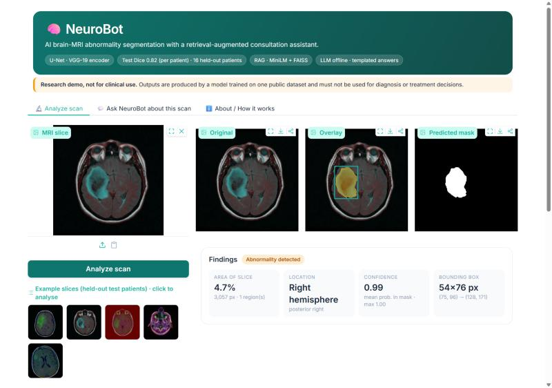
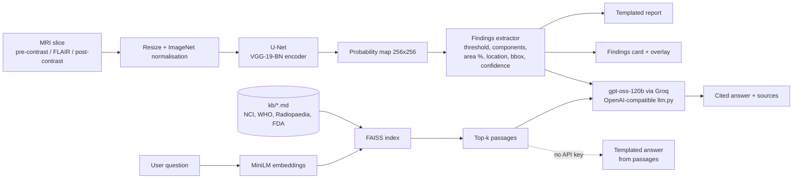
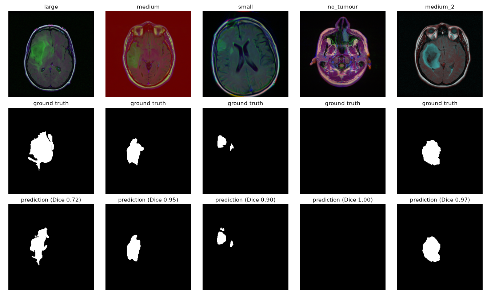
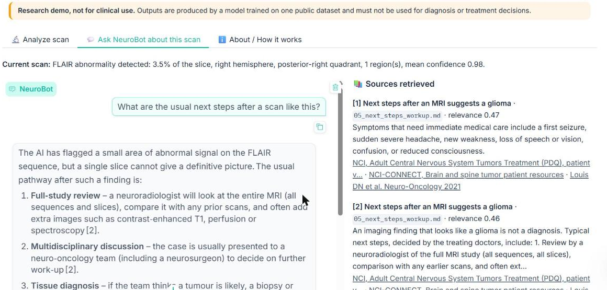

# 🧠 NeuroBot

**AI brain-MRI abnormality segmentation with a retrieval-augmented consultation assistant.**
Upload an MRI slice → a U-Net with a VGG-19 encoder segments FLAIR abnormality → NeuroBot extracts
structured findings, writes a report, and answers questions about the scan with cited sources.

> 🏆 Runner-Up, Xavor × UET GenAI Competition. This repository is a from-scratch rebuild of the original project.
>
> ⚠️ **Research demo, not for clinical use.**



## Features
- **Segmentation**: U-Net with an ImageNet-pretrained **VGG-19 (BN)** encoder (`segmentation_models_pytorch`),
  trained on the LGG Segmentation Dataset with a **patient-level** train/val/test split.
- **Findings extractor**: abnormality present?, area %, hemisphere and quadrant (radiological convention),
  bounding box, number of regions, slice-level confidence; small noisy blobs are filtered out.
- **Auto-generated report**: deterministic structured report (findings, impression, suggested next steps,
  limitations), downloadable as Markdown.
- **"Ask NeuroBot about this scan"**: RAG over a curated knowledge base (`kb/`, NCI / WHO CNS5 / Radiopaedia /
  FDA / dataset papers) with `all-MiniLM-L6-v2` embeddings + FAISS. Answers come from an open-weight LLM on Groq (`openai/gpt-oss-120b` by default)
  and cite the retrieved passages, which are shown alongside.
- **Works without an API key**: no key → retrieved passages + templated summary and an "LLM offline" badge.
- **Polished Gradio UI**: teal medical theme, light/dark mode, one-click example scans from held-out test patients.

## Architecture


## Results
Held-out **test set: 16 patients, 540 slices (192 with tumour)**, never seen in training or model selection.
Split by patient (78 / 16 / 16), seed 42, saved in [`results/splits.json`](results/splits.json).
Computed by `evaluate.py` at native 256x256 after the same post-processing the app uses
(threshold 0.5, components < 40 px removed). Full output: [`results/metrics.json`](results/metrics.json).

| Metric | Value |
|---|---|
| **Per-patient volumetric Dice** (mean / median) | **0.823** / 0.861 |
| Per-patient volumetric IoU (mean) | 0.715 |
| Dice on tumour slices (mean) | 0.834 |
| IoU on tumour slices (mean) | 0.743 |
| Global pixel Dice / IoU | 0.850 / 0.739 |
| Slice-level detection: sensitivity / specificity | 0.995 / 0.862 |
| Slice-level detection: accuracy | 0.909 (TP 191, TN 300, FP 48, FN 1) |

For reference, Buda et al. (2019) report a mean per-patient Dice of 82% on this dataset with a different model
and cross-validation, so the result is in the expected range. The model almost never misses a tumour slice,
but 48 of 348 tumour-free slices get a false-positive region, so a positive call on a single slice needs
review. Training: Kaggle T4 GPU, 256 px, 30 epochs (~20 min), AdamW + OneCycle, BCE + Dice loss; the
checkpoint with the best validation Dice (epoch 12, 0.877) is kept ([`results/train_log_kaggle.json`](results/train_log_kaggle.json)).



<details><summary>"Ask NeuroBot" tab (LLM answer with inline citations and the retrieved sources)</summary>


</details>

## Tech stack
PyTorch · segmentation_models_pytorch (U-Net, VGG-19-BN encoder) · Kaggle GPU (training) · NumPy / SciPy ·
sentence-transformers (all-MiniLM-L6-v2) · FAISS · OpenAI-compatible client (Groq gpt-oss-120b / OpenAI / Ollama) · Gradio 6.

## Quick start
```bash
python -m venv .venv && .venv\Scripts\activate        # macOS/Linux: source .venv/bin/activate
pip install -r requirements.txt
copy .env.example .env                                  # optional: add a free Groq key for LLM answers
python app.py                                           # open http://127.0.0.1:7860
```
The trained weights (`weights/neurobot_unet_vgg19.pt`, fp16, ~58 MB) and example scans are included, so the
app runs without downloading the dataset. The first launch downloads the small MiniLM embedding model (~90 MB).

### Reproduce training and evaluation
```bash
python scripts/download_data.py      # LGG dataset (~750 MB) from a public Hugging Face mirror, resumable
python evaluate.py                   # metrics on the 16 held-out test patients -> results/metrics.json
python train.py --epochs 8           # optional CPU training at 128 px (slow)
```
The released weights were trained on a free Kaggle GPU with [`kaggle/neurobot_train_kaggle.ipynb`](kaggle/neurobot_train_kaggle.ipynb)
(same model, split and checkpoint format; attach the dataset `mateuszbuda/lgg-mri-segmentation` and pick GPU T4).

## Project structure
```
app.py                  Gradio UI
llm.py                  OpenAI-compatible LLM client with offline fallback
neurobot/data.py        dataset index, patient split, cache
neurobot/model.py       U-Net (VGG-19-BN), fp16 checkpoint, inference
neurobot/findings.py    probability map -> structured findings
neurobot/report.py      templated report
neurobot/rag.py         knowledge base chunking, MiniLM + FAISS retrieval, cited answers
kb/                     curated knowledge-base notes with source URLs
train.py / evaluate.py  CPU training and held-out evaluation
kaggle/                 GPU training notebook
results/                splits.json, metrics.json, train log, test figure
examples/               test-patient slices for the demo
```

## Dataset and credits
- **LGG Segmentation Dataset** (kaggle_3m): Mateusz Buda, Ashirbani Saha, Maciej A. Mazurowski,
  "Association of genomic subtypes of lower-grade gliomas with shape features automatically extracted by a deep
  learning algorithm", *Computers in Biology and Medicine* 109 (2019) 218-225.
  [doi:10.1016/j.compbiomed.2019.05.002](https://doi.org/10.1016/j.compbiomed.2019.05.002).
  Images from the TCGA-LGG collection, [The Cancer Imaging Archive](https://www.cancerimagingarchive.net/collection/tcga-lgg/).
  Licensed CC BY-NC-SA 4.0 (non-commercial). Kaggle: `mateuszbuda/lgg-mri-segmentation`; download mirror:
  `gymprathap/Brain-MRI-LGG-Segmentation` on Hugging Face.
- Knowledge-base sources are listed at the end of each note in [`kb/`](kb/).

## Limitations
Single 2-D slices, one public dataset of lower-grade gliomas only, no external validation; FLAIR abnormality is not
specific to tumour. Location assumes the radiological display convention. Not a medical device.

## Authors
Built by **Amna Choudhri** ([@Amna05Chaudhry](https://github.com/Amna05Chaudhry)).

## License
Code: MIT (see `LICENSE`). Dataset and derived weights: subject to the dataset's CC BY-NC-SA 4.0 licence.
